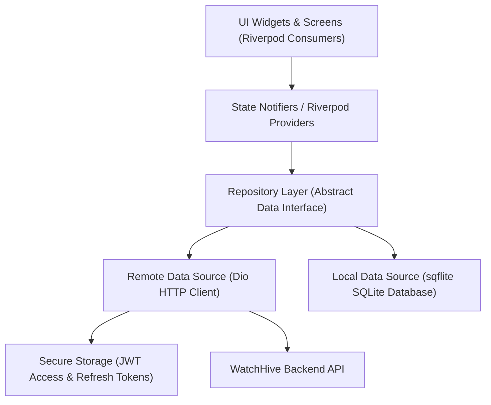

# WatchHive Mobile (Flutter Android & iOS) 📱🎬

> The official native mobile client for **WatchersHive** — engineered for fast, tactile movie & TV show tracking, personalized ranking stacks, community recommendations, and offline-first watch logging with real-time push notifications.

---

## 📌 1. What is this Repo For?

WatchHive Mobile provides a native smartphone experience for cinema enthusiasts:
- **Instant Watch Logging**: Log movies, anime, and series on the go with tactile haptic feedback, custom ratings, and reviews.
- **Ranking Stacks & Curations**: View, organize, and drag-and-drop movie stacks that represent your personal cinematic report card.
- **Movie Suggestions & Impact**: Recommend movies to friends, see whose recommendations you watched, and check your suggester impact.
- **Offline-First Resilience**: Log watches and browse your catalog without an active internet connection; changes automatically queue and sync via local SQLite.
- **Real-Time Push Notifications**: Firebase Cloud Messaging (FCM) alerts when friends suggest movies, comment on your reviews, or follow your activity.

---

## 🛠️ 2. Tech Stack

| Layer | Technology | Details |
| :--- | :--- | :--- |
| **Framework** | Flutter (SDK `>=3.3.0 <4.0.0`) | Google's cross-platform native UI framework |
| **Language** | Dart (v3+) | High-performance, AOT-compiled language with sound null safety |
| **State Management** | Flutter Riverpod (`v2.5.1`) | Compile-safe, reactive state management with dependency injection |
| **Navigation & Deep Links** | GoRouter (`v14.2.0`) | Declarative URL-based routing with deep-linking support |
| **Networking** | Dio (`v5.4.3`) | HTTP client with automatic JWT token attachment, interceptors, and error handling |
| **Secure Token Storage** | Flutter Secure Storage | Keychain (iOS) and AES-encrypted KeyStore (Android) for JWT tokens |
| **Local Offline Database** | SQLite via `sqflite` (`v2.4.4`) | Local relational cache for offline-first data persistence |
| **Connectivity Monitoring** | `connectivity_plus` | Real-time network state detection and automatic offline banner |
| **Image Disk Caching** | `cached_network_image` | Multi-tier memory and disk cache for TMDb movie posters |
| **Push Notifications** | Firebase Cloud Messaging (FCM) | Background & foreground native push alerts with local heads-up notifications |
| **Design System** | Custom Warm Honey Cream | Material 3 glassmorphic design, custom gold accents, Shimmer, and Lottie animations |

---

## 🚀 3. How to Setup

### Prerequisites
- [Flutter SDK](https://docs.flutter.dev/get-started/install) (v3.3.0 or higher)
- Android Studio / Android SDK (Java JDK 17)
- Xcode (for iOS builds on macOS)

Verify your environment readiness:
```bash
flutter doctor
```

### Installation Steps

1. **Clone the repository**:
   ```bash
   git clone https://github.com/dasamantaraoaditya/WatchHive-Mobile.git
   cd WatchHive-Mobile
   ```

2. **Install Flutter packages**:
   ```bash
   flutter pub get
   ```

3. **Configure Environment Variables**:
   Create a `.env` file in the root directory:
   ```env
   # Backend API URL
   # Local Emulator: http://10.0.2.2:5001/api/v1
   # Staging: https://watchhive-api-staging.up.railway.app/api/v1
   # Production: https://watchhive-api-production.up.railway.app/api/v1
   WATCHHIVE_API_URL=https://watchhive-api-production.up.railway.app/api/v1
   ```

4. **Run on an Emulator or Connected Device**:
   ```bash
   # List available devices/emulators
   flutter devices

   # Start the app in debug mode
   flutter run
   ```

5. **Build Release Binaries**:
   ```bash
   # Build Android App Bundle (for Google Play Store)
   flutter build appbundle --release

   # Build Android APK (for direct testing/distribution)
   flutter build apk --release

   # Build iOS IPA
   flutter build ipa --release
   ```

---

## 🏛️ 4. Architecture

WatchHive Mobile follows a **Feature-Driven Clean Architecture** powered by **Riverpod**, enforcing a unidirectional data flow and strict separation between UI, state controllers, and data sources:



### Directory Structure
```text
lib/
├── core/                 # App-wide foundational modules
│   ├── api/              # Dio client, API endpoints, token interceptors
│   ├── database/         # Local sqflite database & migration helpers
│   ├── storage/          # Secure storage wrapper for credentials
│   └── theme/            # Theme constants, Honey Cream colors, typography
├── features/             # Modular feature packages
│   ├── auth/             # Login, register, and splash screens
│   ├── entries/          # Watch log entries, review dialogs, details
│   ├── feed/             # Friend activity feed, likes, and comments
│   ├── profile/          # User stats, avatar uploads, settings
│   ├── search/           # TMDb search, trending movies, filters
│   ├── stacks/           # Ranking stacks, list reordering
│   └── suggestions/      # Movie recommendations & impact tracking
├── shared/               # Reusable widgets (cards, buttons, shimmer loaders)
└── main.dart             # App entry point, Firebase init, Riverpod Scope
```

---

## ⚡ 5. Performance & Mobile Optimizations

The mobile application is optimized for smooth 60fps/120fps display rendering, low battery drain, and resilient offline capabilities:

1. **60fps / 120fps High-Refresh Rendering**:
   * All long lists (`feed`, `entries`, `search results`) utilize `ListView.builder` and `SliverList` with strict lazy view recycling, maintaining smooth 120Hz scrolling on flagship devices without frame drops.
2. **Multi-Tier Poster Disk Caching**:
   * Movie and TV posters are cached to flash storage via `cached_network_image`. Posters are downloaded only once, drastically minimizing network data usage and eliminating image flickering on subsequent visits.
3. **Offline-First SQLite Cache**:
   * User entries and feed items are persisted locally using `sqflite`. If the device goes offline or encounters a poor cellular connection, cached content renders instantly.
4. **Optimistic UI Updates & Instant Feedback**:
   * Toggling a like or saving an entry updates the local Riverpod state immediately while the network request executes asynchronously in the background.
5. **App Bundle & Memory Optimization**:
   * ProGuard rules and R8 code shrinking strip unused bytecode, keeping release Android App Bundles lightweight for quick downloads from Google Play.
