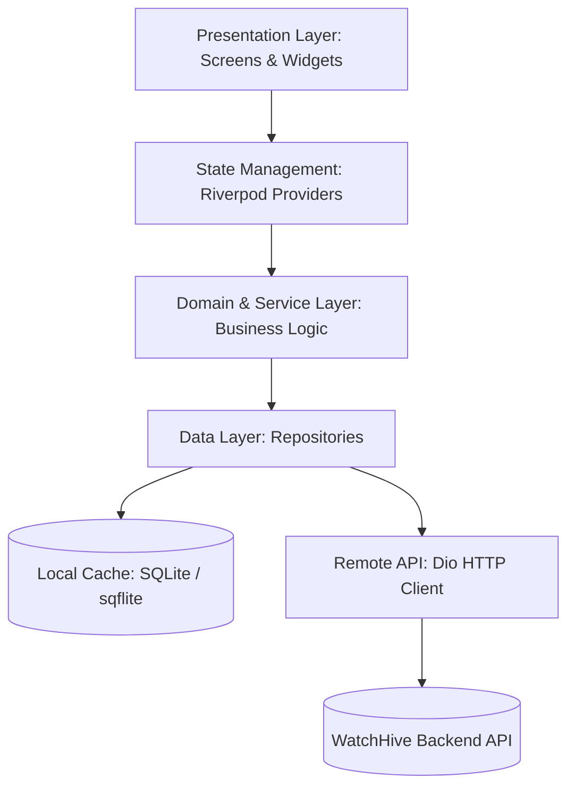
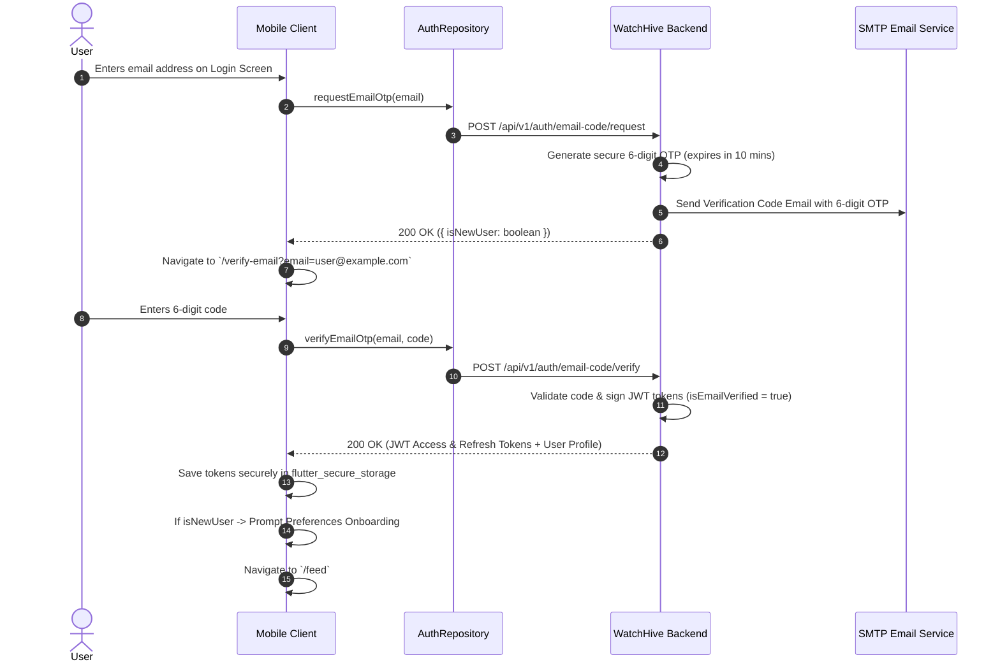
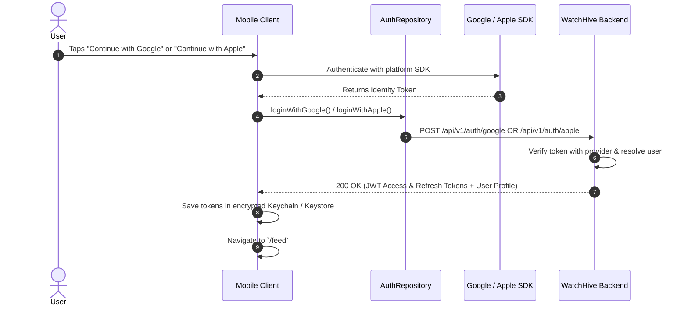
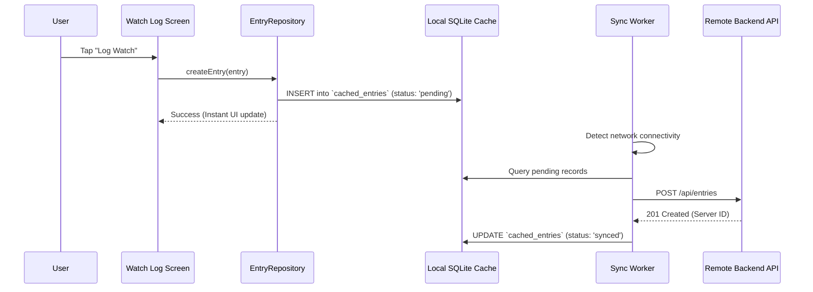

# WatchHive Mobile Architecture & Engineering Blueprint 📱⚙️

> **The Definitive Engineering & Architectural Reference for WatchHive Mobile**  
> *Targeted for Mobile Engineers, Architects, and AI Pair Programming Agents.*  
> *Covers Flutter application layers, Riverpod state graph, offline-first SQLite sync engine, GoRouter deep links, network interceptors, push notifications, 6-digit OTP auth flows, and cross-platform mobile/web UX systems.*

---

## 🏛️ 1. High-Level Architectural Pattern

WatchHive Mobile is engineered following a clean **Layered Feature-First Architecture** with strict separation of concerns:



### Directory Structure Overview
```
lib/
├── core/                       # Cross-cutting foundational modules
│   ├── api/                    # Dio client, API endpoints, token interceptors
│   ├── config/                 # Environment config & web URL builders
│   ├── database/               # Local SQLite database & schema migrations
│   ├── notifications/          # FCM service & local notifications handler
│   ├── router/                 # GoRouter declarations, guards & deep link normalizer
│   ├── services/               # Offline storage & background sync workers
│   ├── theme/                  # AppColors, AppTheme, typography tokens
│   └── utils/                  # Date formatters, sharing helpers, platform utils
├── features/                   # Feature-first domain modules
│   ├── auth/                   # Login, signup, verify email OTP, forgot/reset password
│   ├── entries/                # Watch logging, review modal, details, friends watched
│   ├── feed/                   # Social swarm feed, SmartSuggest carousel, add friends card
│   ├── mindlens/               # Shannon entropy visualization, cognitive archetypes
│   ├── notifications/          # Notification inbox & push opt-in banners
│   ├── onboarding/             # Interactive tour & preferences questionnaire
│   ├── profile/                # User profile, follow stats, friend requests, settings
│   ├── rankings/               # Tier rankings & reorderable movie stacks
│   ├── scanner/                # Hive QR code scanner & camera detector
│   ├── search/                 # TMDb movie/TV search & social user search
│   └── share/                  # Instagram 9:16 story cards & deep-link sharing
└── shared/                     # Shared models, widgets, and dialogs
    ├── models/                 # Strongly-typed Dart data models (Movie, User, Entry)
    └── widgets/                # WHButton, WHFeedCard, ScreenGuideDialog, WHAvatar
```

---

## 🔐 2. Authentication & Identity Flow Architecture

WatchHive implements a **100% Passwordless Authentication Architecture**. Passwords have been phased out across all mobile clients, replacing credential-stuffing vulnerabilities and forgotten password friction with secure 6-digit Email OTP and Google/Apple Single Sign-On.

### A. Passwordless 6-Digit Email OTP Login & Registration Flow



### B. Single Sign-On (Google & Apple ID)



### C. Watch Preferences Synchronization & Concurrency Guards
To eliminate duplicate dialog presentations and ensure users are never re-prompted once preferences exist:
1. **Multi-Store Fallback**:
   - `OnboardingService.resolveUserWithPreferences(user)` checks in-memory cache $\rightarrow$ local SQLite cache $\rightarrow$ SecureStorage $\rightarrow$ remote `GET /users/me`.
   - If substantive preferences exist in any store, onboarding is permanently marked completed and never prompted again.
2. **Presentation Mutex**:
   - `WatchPreferencesOnboardingDialog.show()` enforces a static `_isShowing` lock rejecting duplicate calls while a dialog is active.
   - `_hasPromptedThisLaunch` and `_promptedUserIds` guarantee at most one prompt per user per app launch.

---

## ⚡ 3. State Management (Riverpod)

The application uses **Flutter Riverpod (v2.x)** for compile-safe, dependency-injected reactive state management:

1. **StateNotifier / AsyncNotifier**:
   - Manages asynchronous lifecycle (`AsyncValue<T>`: loading, data, error).
   - Examples: `FeedNotifier`, `AuthNotifier`, `StackNotifier`, `OfflineSyncNotifier`.
2. **AutoDispose & Family Providers**:
   - Providers tied to specific route parameters or movie IDs automatically discard resources when the user leaves the screen (e.g. `movieDetailsProvider(id)`).
3. **Optimistic Updates**:
   - Social interactions (likes, bookmarking to watchlist, gratitude marks) update local state immediately and dispatch background network calls. On failure, state reverts with an animated `WHAlert` toast.

---

## 📴 4. Offline-First SQLite Synchronization Engine

To ensure uninterrupted logging on subways, flights, or poor connectivity, WatchHive Mobile implements an offline-first storage engine:



### Storage Mechanisms
* **Local Database (`sqflite`)**:
  - Relational cache tables: `entries`, `stacks`, `movies`, `profile_cache`, and `sync_queue`.
* **Encrypted KeyStore / Keychain (`flutter_secure_storage`)**:
  - Holds sensitive JWT access tokens, refresh tokens, and device registration identifiers.
* **Network Listener (`connectivity_plus`)**:
  - Monitors transitions between `wifi`, `cellular`, and `none`. Emits connectivity states that automatically flush the `sync_queue` upon reconnect.

---

## 🐝 5. Feed & Community Discovery Subsystem

### A. SmartSuggest Recommendation Engine
- **Horizontal Swipe PageView**: The SmartSuggest deck card supports smooth horizontal sliding across three curated discovery modes:
  - **Social**: Friend watches, mutual reviews, and hive recommendations.
  - **Critic**: High-rating critical consensus and curated acclaim.
  - **Explore**: Cross-genre serendipitous picks nudging beyond comfort zones.

### B. "Diversify Your Feed" Suggested Friends Carousel
- Rendered for new users who follow 0 friends to prevent dead-end feeds.
- **Full Clickability**: Clicking any suggested user's avatar, name, or handle routes to their profile (`/profile/:id`).
- **Interactive Follow / Following Toggle**: Real-time loading indicator on the active button; handles instant follow and unfollow toggling.
- **Web & Desktop Parity**: Configured with `PointerDeviceKind.mouse` drag physics and `<` / `>` scroll arrow buttons for mouse navigation.
- **Persistent Dismissal**: Stored in SecureStorage so dismissing via close (X) or "Cancel" keeps it dismissed permanently.

### C. Review Truncation ("Read More" / "Read Less")
- Long post reviews exceeding standard length thresholds (220 characters) are clamped with clean inline `"Read More"` / `"Read Less"` toggles, preserving feed vertical rhythm.

### D. Friends Watched Pill (Movie Details)
- In `MovieDetailsScreen`, replaces verbose text blocks with a compact row of stacked user avatars (up to 3) + `+N more` counter.
- Tapping opens the interactive **Friends Watched Bottom Sheet** displaying each friend's rating, watch date, and written review.

### E. Instagram Story 9:16 Visual Share Generator
- Generates high-resolution 1080x1920 graphic cards with movie backdrop, title, star rating, user review snippet, and clean hive QR code.
- Restricted exclusively to the user's own watch entries (`isOwnEntry`).

### B. Episode & TV Season Tracking Architecture
- **Repository Layer (`EpisodeRepository`)**: Handles season drill-down, progress metrics, and watch toggles.
- **Granular Episode Checklist**: Users mark individual episodes watched/unwatched with optimistic UI state changes.
- **Batch Catch-Up (`batchCatchUp`)**: Single tap marks all preceding episodes up to S{x}E{y} as watched in one transactional call.
- **Continue Watching Tray (`ContinueWatchingTray`)**: Surfaces in-progress series directly in the feed with the next up episode.
- **Friends Who Watched & Friends Progress**: Queries `/shows/:tmdbId/friends-progress` to display which friends have watched the show and their current season/episode position.

---

## 🌐 6. Network & Security Architecture

### Dio HTTP Client
- **Base URL Configuration**: Switchable via `.env`, `.env.staging`, and `.env.production`.
- **JWT Interceptor**:
  - Intercepts outgoing requests to attach `Authorization: Bearer <access_token>`.
  - On `401 Unauthorized`, queues failed requests, invokes `POST /api/v1/auth/refresh`, updates the stored token, and retries original requests seamlessly.
- **TMDb SWR Caching Interceptor**:
  - Automatically caches TMDb endpoint responses in-memory for 10m to 7 days.
  - Single-flight request deduplication awaits in-flight identical calls.
  - Stale cache fallback ensures offline resilience.
- **SSL / TLS**: All communication is enforced over HTTPS with strict TLS 1.3 protocol validation.

---

## 🧭 7. Navigation & Deep Linking (GoRouter)

Declarative routing configured in [`lib/core/router/app_router.dart`](file:///Users/adityadasamantharao/Documents/Repos/watchhive_mobile/lib/core/router/app_router.dart):

* **URL Schemes**: Supports both custom URI scheme (`watchershive://` / `watchhive://`) and Universal Links / App Links (`https://watchershive.com/`).
* **Route Configuration Table**:
  | Route | Description | Auth Requirement |
  | :--- | :--- | :--- |
  | `/splash` | Cold launch & session restore router | Public |
  | `/login` | Passwordless Email OTP, Google & Apple Sign-In | Unauthenticated only |
  | `/verify-email` | 6-digit email confirmation OTP input | Public |
  | `/feed` | Main community swarm activity feed | Authenticated |
  | `/mindlens` | AI taste analytics & entropy quadrant | Authenticated |
  | `/entries` | User watch history, watchlist, stacks & suggestions | Authenticated |
  | `/search` | TMDb media search & user directory | Authenticated |
  | `/profile/:id` | User profile, follow stats, and activity | Authenticated |
  | `/details/:mediaType/:tmdbId` | Movie & TV show detail page | Public (Optional Auth) |
  | `/scanner` | QR code camera scanner for hive codes | Authenticated |
  | `/support` | Help center, FAQs, and ticket submission | Public |
  | `/privacy-policy` | Terms of service and privacy statement | Public |

* **Deep Link Normalization**: Automatically normalizes legacy paths (e.g. `/watch-hive/profile/:id` $\rightarrow$ `/profile/:id`) and custom schemes.
* **Pending Deep Link Buffer**: Caches deep links arrived during cold boot or while auth state is resolving, navigating directly to the destination post-login.

---

## 🔔 8. Push Notifications Subsystem

1. **Firebase Cloud Messaging (FCM)**:
   - Registers device FCM token upon login via `FirebaseMessaging.instance.getToken()`.
   - Sends token to backend `POST /api/notifications/fcm-token`.
2. **Foreground Notification Handling**:
   - Handled via `flutter_local_notifications` to display native heads-up banners while the app is active.
3. **Notification Routing**:
   - Tapping a notification parses payload data (e.g. `type: 'SUGGESTION'`, `targetId: '...'`) and triggers `context.push()` to the relevant screen.

---

## 🎨 9. UI/UX Standards & Responsive Integration

All screens strictly adhere to [UI_UX_DESIGN_STANDARDS.md](file:///Users/adityadasamantharao/Documents/Repos/watchhive_mobile/docs/UI_UX_DESIGN_STANDARDS.md):
- **Warm Honey Cream Theme**: `AppColors.primary: #FFB700`, `AppColors.background: #FFF9F0`, `AppColors.surface: #FFFFFF`.
- **Golden Contrast Rule**: All typography on gold, amber, or cream surfaces uses dark charcoal `#2D2926` or `#1E1B18` for AAA readability.
- **Wide-Screen / Web Viewport Parity**: Modal bottom sheets on desktop/web are centered and constrained (`maxWidth: 600px`), preventing excessive horizontal stretching.
- **Tactile Haptic Feedback**: Standardized tactile responses across actions (`HapticFeedback.lightImpact()`, `selectionClick()`).

---

## 🧪 10. Testing Strategy

1. **Unit Tests**:
   - Test data models, JSON serialization, and business logic providers under `test/`.
2. **Widget Tests**:
   - Verify widget rendering, button taps, and contrast compliance.
3. **Integration & Flow Tests**:
   - Verify offline sync lifecycle, OTP input validation, and password reset flows with mocked repositories.
