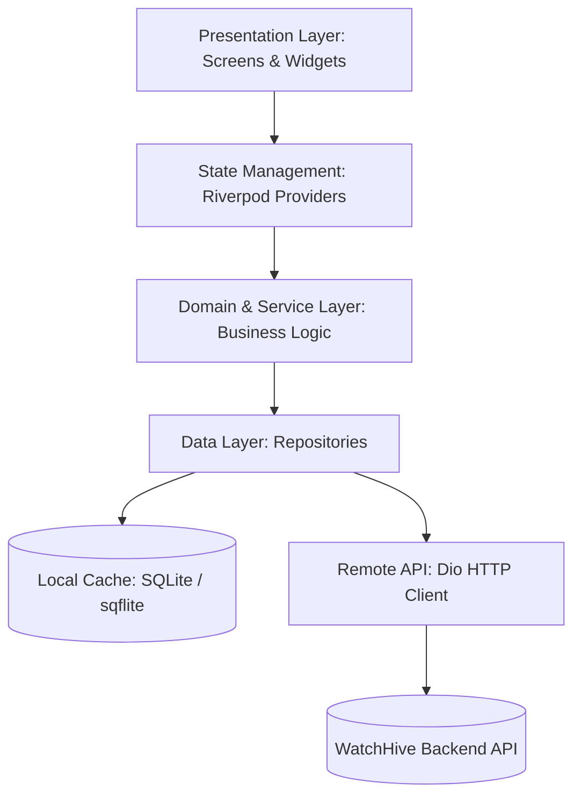
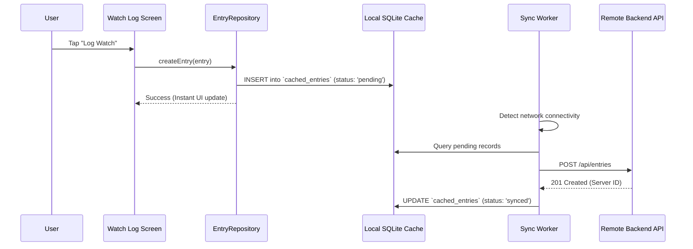

# WatchHive Mobile Architecture & Engineering Blueprint 📱⚙️

> **The Definitive Engineering & Architectural Reference for WatchHive Mobile**  
> *Targeted for Mobile Engineers, Architects, and AI Pair Programming Agents.*  
> *Covers Flutter application layers, Riverpod state graph, offline-first SQLite sync engine, GoRouter deep links, network interceptors, push notifications, and testing strategies.*

---

## 🏛️ 1. High-Level Architectural Pattern

WatchHive Mobile is engineered following a clean **Layered Feature-First Architecture** with strict separation of concerns:



### Directory Structure Overview
```
lib/
├── core/                       # Cross-cutting foundational modules
│   ├── constants/              # Global constants & API endpoints
│   ├── network/                # Dio client, JWT token interceptors, connectivity
│   ├── storage/                # SQLite database helper & secure key-value storage
│   ├── theme/                  # AppColors, AppTheme, typography tokens
│   └── utils/                  # Date formatters, sharing helpers, platform utils
├── features/                   # Feature-first domain modules
│   ├── auth/                   # Login, signup, password reset, Apple/Google OAuth
│   ├── entries/                # Watch logging, rating picker, quick edit modals
│   ├── feed/                   # Social activity feed, reviews, likes, comments
│   ├── mindlens/               # Shannon entropy visualization, cognitive archetypes
│   ├── notifications/          # Notification inbox & push opt-in banners
│   ├── onboarding/             # Interactive walkthrough & watch preference questionnaires
│   ├── profile/                # User profile, statistics, friend requests, settings
│   ├── search/                 # TMDb movie/TV search & social user search
│   ├── stacks/                 # Reorderable ranked movie stacks (report cards)
│   └── suggestions/            # Direct friend recommendations & SmartSuggest deck
└── shared/                     # Shared models, widgets, and dialogs
    ├── models/                 # Strongly-typed Dart data models (Movie, User, Entry)
    └── widgets/                # WHButton, WHFeedCard, ScreenGuideDialog, Alert sheets
```

---

## ⚡ 2. State Management (Riverpod)

The application uses **Flutter Riverpod (v2.x)** for compile-safe, dependency-injected reactive state management:

1. **StateNotifier / AsyncNotifier**:
   - Manages asynchronous lifecycle (`AsyncValue<T>`: loading, data, error).
   - Examples: `FeedNotifier`, `AuthNotifier`, `StackNotifier`, `OfflineSyncNotifier`.
2. **AutoDispose & Family Providers**:
   - Providers tied to specific route parameters or movie IDs automatically discard resources when the user leaves the screen (e.g. `movieDetailsProvider(id)`).
3. **Optimistic Updates**:
   - Social interactions (e.g., likes, bookmarking to watchlist, gratitude marks) update local state immediately, dispatching background network calls. On failure, state reverts with an animated `WHAlert` toast.

---

## 📴 3. Offline-First SQLite Synchronization Engine

To ensure uninterrupted logging on subways, flights, or poor connectivity, WatchHive Mobile implements an offline-first storage engine:



### Storage Mechanisms
* **Local Database (`sqflite`)**:
  - Relational cache tables: `entries`, `stacks`, `movies`, `profile_cache`, and `sync_queue`.
* **Encrypted KeyStore / Keychain (`flutter_secure_storage`)**:
  - Holds sensitive JWT access tokens, refresh tokens, and device registration identifiers.
* **Network Listener (`connectivity_plus`)**:
  - Monitors transitions between `wifi`, `cellular`, and `none`. Emits connectivity states that automatically flush the `sync_queue` upon reconnect.

---

## 🌐 4. Network & Security Architecture

### Dio HTTP Client
- **Base URL Configuration**: Switchable via `.env`, `.env.staging`, and `.env.production`.
- **JWT Interceptor**:
  - Intercepts outgoing requests to attach `Authorization: Bearer <access_token>`.
  - On `401 Unauthorized`, queues failed requests, invokes `POST /api/auth/refresh-token`, updates the stored token, and retries original requests seamlessly.
- **SSL / TLS**: All communication is enforced over HTTPS with strict TLS 1.3 protocol validation.

---

## 🧭 5. Navigation & Deep Linking (GoRouter)

Declarative routing configured in `lib/core/routing/app_router.dart`:

* **URL Schemes**: Supports both custom URI scheme (`watchhive://`) and Universal Links / App Links (`https://watchershive.com/`).
* **Route Configuration**:
  ```
  /                       -> FeedScreen (Main tab)
  /search                 -> SearchScreen
  /stacks                 -> StacksScreen
  /profile/:userId        -> ProfileScreen
  /movie/:tmdbId          -> MovieDetailsScreen
  /onboarding/preferences -> WatchPreferencesScreen
  /password-reset         -> ResetPasswordScreen (Deep Link Target)
  ```
* **Guards & Redirects**: Automatically routes unauthenticated users away from private tabs to `/login`, redirecting back upon authentication.

---

## 🔔 6. Push Notifications Subsystem

1. **Firebase Cloud Messaging (FCM)**:
   - Registers device FCM token upon login via `FirebaseMessaging.instance.getToken()`.
   - Sends token to backend `POST /api/notifications/fcm-token`.
2. **Foreground Notification Handling**:
   - Handled via `flutter_local_notifications` to display native heads-up banners while the app is active.
3. **Notification Routing**:
   - Tapping a notification parses payload data (e.g. `type: 'SUGGESTION'`, `targetId: '...'`) and triggers `context.push()` to the relevant screen.

---

## 🎨 7. UI/UX Standards & Theming Integration

All screens strictly adhere to [UI_UX_DESIGN_STANDARDS.md](file:///Users/adityadasamantharao/Documents/Repos/watchhive_mobile/docs/UI_UX_DESIGN_STANDARDS.md):
- Warm Honey Cream theme (`AppColors.primary: #FFB700`, `AppColors.background: #FFF9F0`).
- Strict Golden Contrast Rule (all text on gold/cream is `#2D2926`).
- Integrated help icon (`ScreenGuideDialog`) in the top-right AppBar across all pages.
- Standardized tactile haptic feedback (`HapticFeedback.lightImpact()`, `selectionClick()`).

---

## 🧪 8. Testing Strategy

1. **Unit Tests**:
   - Test data models, JSON serialization, and business logic providers under `test/unit/`.
2. **Widget Tests**:
   - Verify widget rendering, button presses, and contrast compliance under `test/widgets/`.
3. **Integration & Flow Tests**:
   - Verify offline sync lifecycle and authentication flows with mocked repositories.
